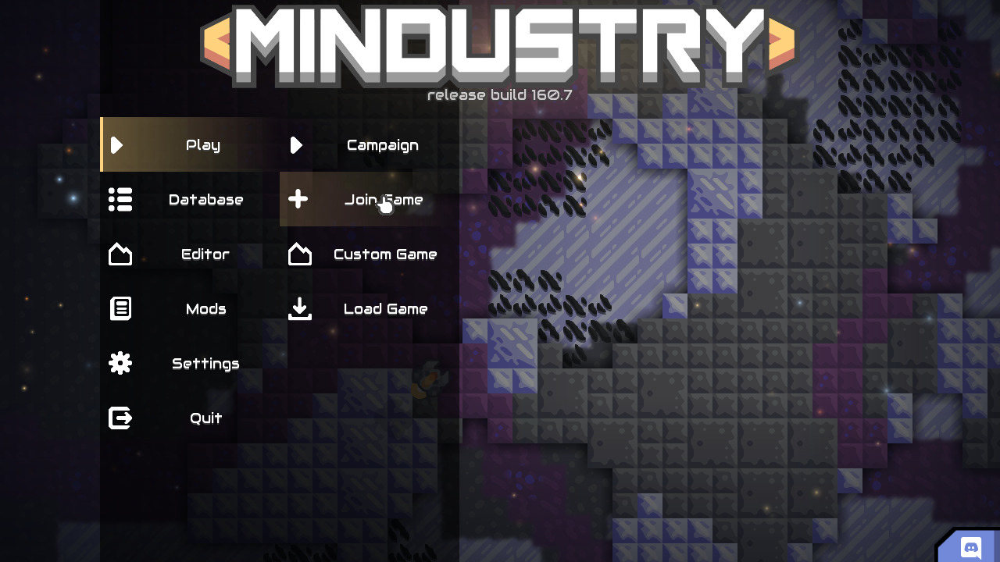
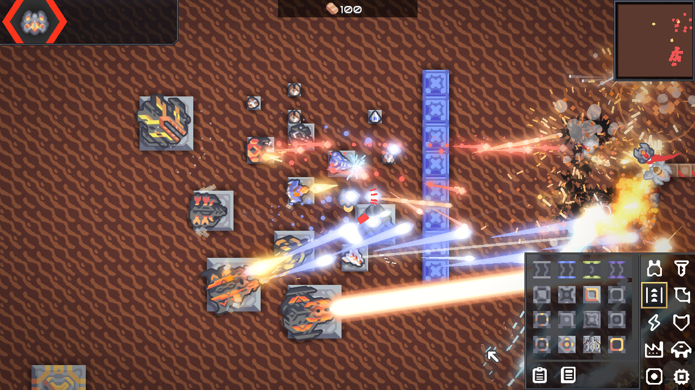
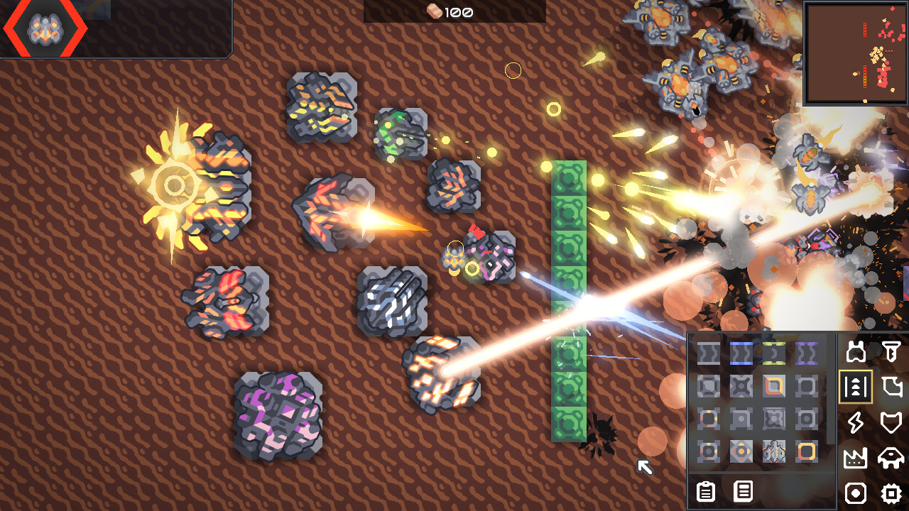
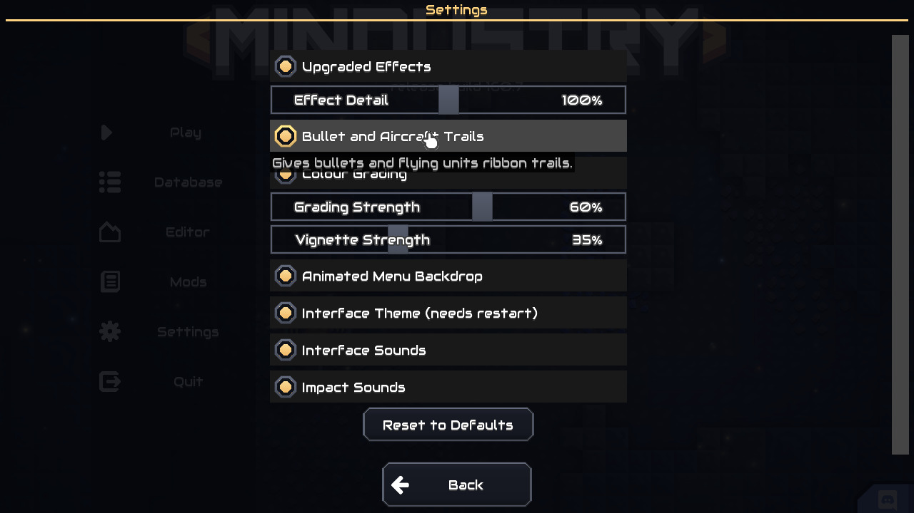
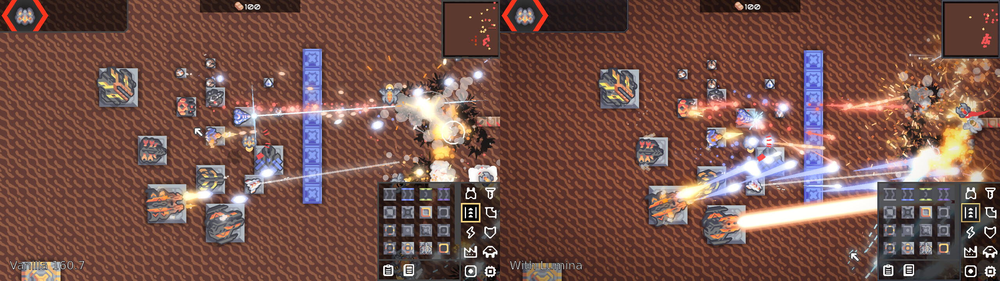

# Lumina - Visual Overhaul

A client-side mod for **Mindustry v8 build 160.7** that upgrades how the game looks and sounds without touching gameplay.
It adds no content, so it works in multiplayer and does not have to be installed on the server.



## What it does

- **Turret, bullet and explosion effects** - 74 vanilla effects get extra layers: muzzle flashes with flares and sparks,
  lingering barrel smoke, impact glows and embers, shockwave rings, electric arcs, and bigger, smokier explosions.
  The upgrades are layered onto the vanilla effects in place, so every turret, unit and block that uses them benefits.
- **Trails** - bullets and flying units leave ribbon trails.
- **Colour grading** - richer colours, deeper contrast and a soft vignette for the world view (the HUD is not affected).
- **Interface theme** - restyled panels, buttons, bars, checkboxes and sliders everywhere, plus dimmed dialog backgrounds.
- **Main menu** - animated backdrop with shading and drifting embers, and accent-coloured menu buttons.
- **Sounds** - soft hover and dialog sounds, and a low rumble / debris layer when large units and buildings are destroyed.
  No vanilla sound is replaced.

Everything can be tuned or switched off under **Settings > Lumina**.

| | |
|---|---|
|  |  |
|  |  |

## Installing

1. Build the jar (see below) or download `Lumina.jar` from a release.
2. In Mindustry open **Mods > Import Mod > Import File** and pick the jar, then restart the game.

`Lumina.jar` built with `./gradlew deploy` contains both desktop and Android code.

## Building

Requires JDK 17.

```
./gradlew jar      # desktop only  -> build/libs/LuminaDesktop.jar
./gradlew deploy   # desktop + Android -> build/libs/Lumina.jar
```

`deploy` needs the Android SDK (`ANDROID_HOME` set, a platform installed) and `d8` from the build-tools on the `PATH`.

## Regenerating assets

The art and sounds are generated by the scripts in `tools/` (Python 3 with Pillow and numpy; ffmpeg for the sounds):

```
python3 tools/gen_ui.py <Mindustry source>/core/assets-raw/sprites/ui assets/lumina-ui
python3 tools/gen_sprites.py .
python3 tools/gen_sounds.py assets/sounds
```

`gen_ui.py` restyles the game's own UI sprites and keeps their exact size, so the game's nine-patch metadata stays valid.

## Layout

- `src/lumina/fx` - effect upgrades (`FxOverhaul`, `Fxd`) and trails (`ContentTweaks`)
- `src/lumina/graphics` - colour grading post-process
- `src/lumina/ui` - interface theme and menu backdrop
- `src/lumina/audio` - extra sounds
- `assets/` - packaged into the mod jar as-is
